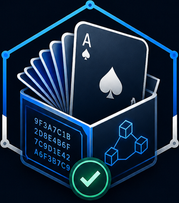
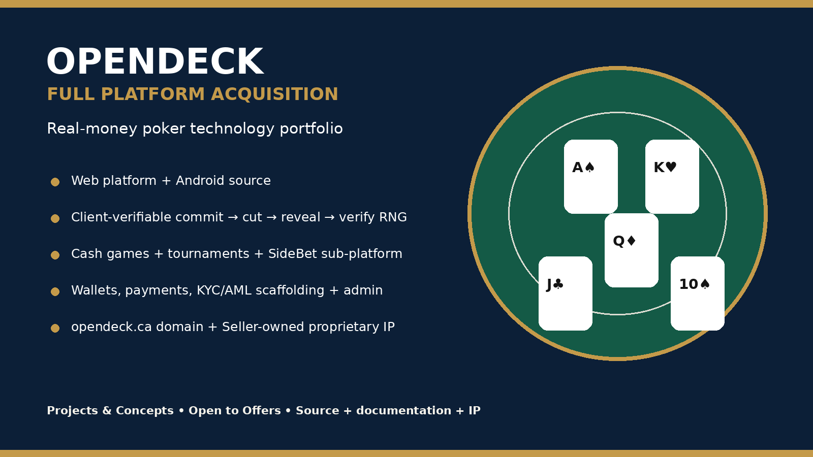
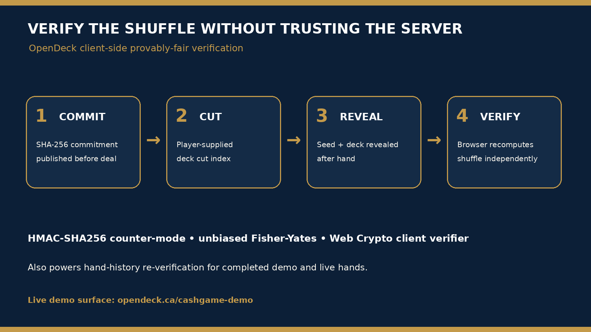
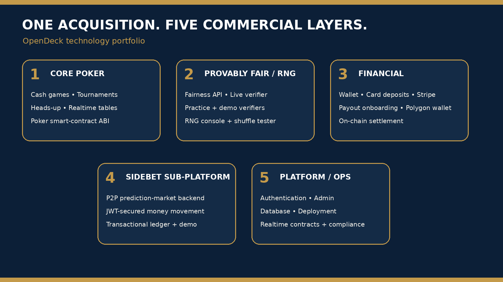

<p align="center">
  
</p>

# OpenDeck — Transparent Poker

**Live:** [opendeck.ca](https://opendeck.ca)

OpenDeck is a full-stack multiplayer poker platform built end to end by a single developer — a React/TypeScript web app, a Node.js/Express API with a PostgreSQL database, real-time play over WebSockets, integrated wallet and payments, and a **provably fair shuffle** that any player can independently verify.



## Why it's different: provably fair by design

Most online poker asks players to trust that the shuffle was fair. OpenDeck proves it, using a cryptographic **commit–reveal** scheme:

1. **Commit** — before a hand, the server generates a secret seed, deterministically shuffles the deck from it, and publishes only `SHA-256(seed)`.
2. **Cut** — the player supplies a cut index, contributing their own randomness; the server publishes a commitment to the post-cut deck (never the card values).
3. **Reveal** — after the hand, the seed and the real deck order are published.
4. **Verify** — anyone can recompute the hash, re-run the deterministic shuffle (HMAC-SHA256 in counter mode driving an unbiased Fisher–Yates shuffle), apply the cut, and confirm the deck that was committed to is the deck that was dealt.

The engine (`backend/commitRevealEngine.js`) is deliberately dependency-free — Node's built-in `crypto` only — so it can be audited in isolation, and the same verification runs client-side in the browser. A provisional patent application has been filed for the shuffle.



## Features

- **Accounts & security** — registration/login with bcrypt + JWT, role-based admin access, KYC and account-control models
- **Cash games & tournaments** — lobbies, tables, registration/rebuy/add-on flows, tournament scheduler, hand histories
- **Wallet & ledger** — balances and a transaction ledger; deposits settle on confirmation, withdrawals freeze funds pending admin approval
- **Payments** — Stripe deposits via PaymentIntents + webhooks, Stripe Connect, ACH/crypto settlement paths, on-chain USDC/Polygon wallets via ethers.js and a Solidity contract (`OpenDeckPoker.sol`)
- **Admin** — dashboard routers for withdrawals, payouts, user and tournament management
- **Demos** — play-money cash-game, heads-up, and RNG shuffle-tester tables (in-memory, no account needed)

## Architecture



| Layer | Stack |
|---|---|
| Frontend | React 19, TypeScript, Vite, React Router |
| Backend | Node.js, Express, WebSockets (`ws`) |
| Data | PostgreSQL, Sequelize ORM, `node-pg-migrate` migrations |
| Payments | Stripe API + webhooks, Stripe Connect, Modern Treasury, ethers.js / Polygon (USDC) |
| Auth | JWT, bcrypt, Privy |
| Docs & tooling | OpenAPI 3.0 + Swagger UI, Postman collection, Docker / Docker Compose, nginx |

## Repository structure

```
frontend/    React/TypeScript app (src: pages, components, typed API layer, ws)
backend/     Express API (routers, services, models, migrations, scheduler)
  docs/api/  OpenAPI spec + Postman collection
  contracts/ OpenDeckPoker.sol + deployment scripts
docs/images/ Screenshots and diagrams used in this README
```

## Running locally

Prerequisites: Node.js 20+, PostgreSQL (or use the Docker Compose database), and your own API keys for the services you want to exercise (Stripe, Privy, etc.).

**Backend**

```bash
cd backend
cp .env.example .env   # fill in your own values — never commit this file
npm install
npm run dev            # or: docker compose up
```

The API serves Swagger UI from the OpenAPI spec at `/docs` when running.

**Frontend**

```bash
cd frontend
cp .env.example .env   # point VITE_API_BASE_URL at your backend
npm install
npm run dev
```

## API documentation

- OpenAPI 3.0 spec: `backend/docs/api/openapi.yaml`
- Postman collection: `backend/docs/api/OpenDeck.postman_collection.json` (environment file contains only local-dev placeholders)

## Testing

```bash
cd backend
npm test
```

End-to-end and demo-flow scripts live alongside the backend (`e2e_test.js`, `demo_betting_test.js`). Test coverage is an active area of work — the shuffle engine and wallet ledger are the highest-value targets and are structured for it (the engine is pure functions with no I/O).

## Project notes

- This codebase was assembled and hardened over several passes; `backend/README.md` and `backend/CHANGELOG_FIXES.md` keep an honest record of design decisions, trade-offs (for example, model-sync bootstrapping vs. full migrations), and known gaps.
- Seed data (`backend/db/seed.js`) creates demo accounts under `@opendeck.local` for local development only.

## License / ownership

Copyright © 2026 Ryan Walton / SoverraAI Inc. All rights reserved.
This repository is published for portfolio and evaluation purposes; no license is granted to reuse the code commercially.
